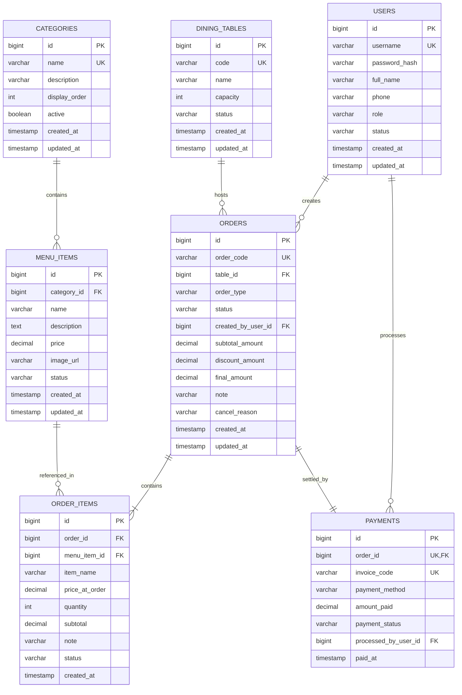

# Thiết Kế Cơ Sở Dữ Liệu - Hệ Thống Quản Lý Quán Ăn
(Database Architecture & Schema Specification)

- **Mã tài liệu:** `DOC_DB_01`
- **Hệ quản trị CSDL:** MySQL 8.0+
- **Công cụ quản lý schema:** Flyway Migration
- **Mã hóa ký tự:** `utf8mb4` / `utf8mb4_unicode_ci`

---

## 1. Sơ đồ quan hệ thực thể (ERD - Entity Relationship Diagram)

---

## 2. Chi tiết cấu trúc các bảng (Data Dictionaries)

### 2.1. Bảng `users` (Tài khoản người dùng)
Lưu trữ thông tin xác thực và phân quyền nhân viên, chủ quán.

| Tên cột | Kiểu dữ liệu | Ràng buộc | Mô tả |
|---|---|---|---|
| `id` | `BIGINT` | PK, AUTO_INCREMENT | Mã định danh duy nhất |
| `username` | `VARCHAR(50)` | NOT NULL, UNIQUE | Tên đăng nhập hệ thống |
| `password_hash` | `VARCHAR(255)` | NOT NULL | Mật khẩu đã băm bằng thuật toán BCrypt |
| `full_name` | `VARCHAR(100)` | NOT NULL | Họ và tên nhân viên |
| `phone` | `VARCHAR(20)` | NULL | Số điện thoại liên hệ |
| `role` | `VARCHAR(20)` | NOT NULL, DEFAULT 'STAFF' | Vai trò: `ADMIN`, `STAFF` |
| `status` | `VARCHAR(20)` | NOT NULL, DEFAULT 'ACTIVE' | Trạng thái: `ACTIVE`, `INACTIVE` |
| `created_at` | `TIMESTAMP` | NOT NULL, DEFAULT CURRENT_TIMESTAMP | Thời điểm tạo |
| `updated_at` | `TIMESTAMP` | NOT NULL, DEFAULT CURRENT_TIMESTAMP ON UPDATE CURRENT_TIMESTAMP | Thời điểm cập nhật |

---

### 2.2. Bảng `categories` (Danh mục món ăn)
Phân loại thực đơn (Món khai vị, Món chính, Đồ uống, v.v.).

| Tên cột | Kiểu dữ liệu | Ràng buộc | Mô tả |
|---|---|---|---|
| `id` | `BIGINT` | PK, AUTO_INCREMENT | Mã danh mục |
| `name` | `VARCHAR(100)` | NOT NULL, UNIQUE | Tên danh mục món ăn |
| `description` | `VARCHAR(255)` | NULL | Mô tả tóm tắt |
| `display_order` | `INT` | NOT NULL, DEFAULT 0 | Thứ tự hiển thị ưu tiên trên menu |
| `active` | `BOOLEAN` | NOT NULL, DEFAULT TRUE | Trạng thái hiển thị (TRUE = hiện, FALSE = ẩn) |
| `created_at` | `TIMESTAMP` | NOT NULL, DEFAULT CURRENT_TIMESTAMP | Thời điểm tạo |
| `updated_at` | `TIMESTAMP` | NOT NULL, DEFAULT CURRENT_TIMESTAMP ON UPDATE CURRENT_TIMESTAMP | Thời điểm cập nhật |

---

### 2.3. Bảng `menu_items` (Món ăn / Đồ uống)
Quản lý danh sách món, đơn giá niêm yết và trạng thái còn/hết.

| Tên cột | Kiểu dữ liệu | Ràng buộc | Mô tả |
|---|---|---|---|
| `id` | `BIGINT` | PK, AUTO_INCREMENT | Mã món |
| `category_id` | `BIGINT` | NOT NULL, FK(`categories.id`) | Khóa ngoại trỏ về danh mục (ON DELETE RESTRICT) |
| `name` | `VARCHAR(150)` | NOT NULL | Tên món ăn |
| `description` | `TEXT` | NULL | Thành phần, hương vị, mô tả |
| `price` | `DECIMAL(12, 2)` | NOT NULL, CHECK(`price` >= 0) | Đơn giá niêm yết hiện tại |
| `image_url` | `VARCHAR(500)` | NULL | Đường dẫn URL hình ảnh món |
| `status` | `VARCHAR(20)` | NOT NULL, DEFAULT 'AVAILABLE' | Trạng thái: `AVAILABLE` (còn bán), `OUT_OF_STOCK` (hết món) |
| `created_at` | `TIMESTAMP` | NOT NULL, DEFAULT CURRENT_TIMESTAMP | Thời điểm tạo |
| `updated_at` | `TIMESTAMP` | NOT NULL, DEFAULT CURRENT_TIMESTAMP ON UPDATE CURRENT_TIMESTAMP | Thời điểm cập nhật |

*Chỉ mục bổ sung (Indexes):*
- `idx_menu_items_category` ON `menu_items(category_id)`
- `idx_menu_items_status` ON `menu_items(status)`

---

### 2.4. Bảng `dining_tables` (Bàn ăn)
Quản lý vị trí bàn và trạng thái phục vụ.

| Tên cột | Kiểu dữ liệu | Ràng buộc | Mô tả |
|---|---|---|---|
| `id` | `BIGINT` | PK, AUTO_INCREMENT | Mã định danh bàn |
| `code` | `VARCHAR(30)` | NOT NULL, UNIQUE | Mã bàn ngắn (Ví dụ: `B01`, `B02`, `VIP01`) |
| `name` | `VARCHAR(100)` | NOT NULL | Tên bàn hiển thị (Ví dụ: "Bàn 1 (Tầng 1)") |
| `capacity` | `INT` | NOT NULL, DEFAULT 4 | Số ghế / sức chứa tối đa |
| `status` | `VARCHAR(20)` | NOT NULL, DEFAULT 'EMPTY' | Trạng thái: `EMPTY` (trống), `OCCUPIED` (có khách), `RESERVED` (đã đặt) |
| `created_at` | `TIMESTAMP` | NOT NULL, DEFAULT CURRENT_TIMESTAMP | Thời điểm tạo |
| `updated_at` | `TIMESTAMP` | NOT NULL, DEFAULT CURRENT_TIMESTAMP ON UPDATE CURRENT_TIMESTAMP | Thời điểm cập nhật |

*Chỉ mục bổ sung (Indexes):*
- `idx_dining_tables_status` ON `dining_tables(status)`

---

### 2.5. Bảng `orders` (Đơn hàng)
Thông tin tổng quan của lượt gọi món tại bàn hoặc mang về.

| Tên cột | Kiểu dữ liệu | Ràng buộc | Mô tả |
|---|---|---|---|
| `id` | `BIGINT` | PK, AUTO_INCREMENT | Mã định danh đơn hàng |
| `order_code` | `VARCHAR(30)` | NOT NULL, UNIQUE | Mã đơn hàng (Ví dụ: `ORD-20261020-0001`) |
| `table_id` | `BIGINT` | NULL, FK(`dining_tables.id`) | Khóa ngoại bàn ăn (NULL nếu mang về) |
| `order_type` | `VARCHAR(20)` | NOT NULL, DEFAULT 'DINE_IN' | Loại đơn: `DINE_IN` (tại bàn), `TAKEAWAY` (mang về) |
| `status` | `VARCHAR(20)` | NOT NULL, DEFAULT 'PENDING' | Trạng thái: `PENDING` (đang mở), `PAID` (đã thanh toán), `CANCELLED` (đã hủy) |
| `created_by_user_id` | `BIGINT` | NOT NULL, FK(`users.id`) | Nhân viên mở đơn |
| `subtotal_amount` | `DECIMAL(12, 2)` | NOT NULL, DEFAULT 0.00 | Tổng tiền món chưa chiết khấu |
| `discount_amount` | `DECIMAL(12, 2)` | NOT NULL, DEFAULT 0.00 | Số tiền được giảm giá |
| `final_amount` | `DECIMAL(12, 2)` | NOT NULL, DEFAULT 0.00 | Tiền thực thu sau giảm giá (`subtotal - discount`) |
| `note` | `VARCHAR(255)` | NULL | Ghi chú chung của đơn hàng |
| `cancel_reason` | `VARCHAR(255)` | NULL | Lý do hủy đơn (bắt buộc khi CANCELLED) |
| `created_at` | `TIMESTAMP` | NOT NULL, DEFAULT CURRENT_TIMESTAMP | Thời điểm mở đơn |
| `updated_at` | `TIMESTAMP` | NOT NULL, DEFAULT CURRENT_TIMESTAMP ON UPDATE CURRENT_TIMESTAMP | Thời điểm cập nhật |

*Chỉ mục bổ sung (Indexes):*
- `idx_orders_table_status` ON `orders(table_id, status)`
- `idx_orders_status` ON `orders(status)`
- `idx_orders_created_at` ON `orders(created_at)`

---

### 2.6. Bảng `order_items` (Chi tiết dòng món trong đơn)
Lưu từng món ăn được gọi kèm theo snapshot đơn giá tại thời điểm gọi.

| Tên cột | Kiểu dữ liệu | Ràng buộc | Mô tả |
|---|---|---|---|
| `id` | `BIGINT` | PK, AUTO_INCREMENT | Mã dòng món |
| `order_id` | `BIGINT` | NOT NULL, FK(`orders.id`) | Khóa ngoại đơn hàng (ON DELETE CASCADE) |
| `menu_item_id` | `BIGINT` | NOT NULL, FK(`menu_items.id`) | Khóa ngoại món ăn gốc |
| `item_name` | `VARCHAR(150)` | NOT NULL | **Snapshot tên món** tại lúc đặt |
| `price_at_order` | `DECIMAL(12, 2)` | NOT NULL | **Snapshot đơn giá** tại lúc đặt |
| `quantity` | `INT` | NOT NULL, CHECK(`quantity` > 0) | Số lượng gọi món |
| `subtotal` | `DECIMAL(12, 2)` | NOT NULL | Thành tiền (`price_at_order * quantity`) |
| `note` | `VARCHAR(255)` | NULL | Ghi chú món (ví dụ: "ít cay", "không đường") |
| `status` | `VARCHAR(20)` | NOT NULL, DEFAULT 'PENDING' | Trạng thái: `PENDING`, `COOKING`, `SERVED`, `CANCELLED` |
| `created_at` | `TIMESTAMP` | NOT NULL, DEFAULT CURRENT_TIMESTAMP | Thời điểm gọi món |

*Chỉ mục bổ sung (Indexes):*
- `idx_order_items_order` ON `order_items(order_id)`

---

### 2.7. Bảng `payments` (Lịch sử thanh toán & Hóa đơn)
Lưu trữ thông tin giao dịch thanh toán hoàn tất cho mỗi đơn hàng.

| Tên cột | Kiểu dữ liệu | Ràng buộc | Mô tả |
|---|---|---|---|
| `id` | `BIGINT` | PK, AUTO_INCREMENT | Mã giao dịch thanh toán |
| `order_id` | `BIGINT` | NOT NULL, UNIQUE, FK(`orders.id`) | Đơn hàng thanh toán (Quan hệ 1-1 với đơn) |
| `invoice_code` | `VARCHAR(30)` | NOT NULL, UNIQUE | Mã số hóa đơn (Ví dụ: `INV-20261020-0001`) |
| `payment_method` | `VARCHAR(20)` | NOT NULL | Phương thức: `CASH` (tiền mặt), `BANK_TRANSFER` (chuyển khoản QR) |
| `amount_paid` | `DECIMAL(12, 2)` | NOT NULL | Số tiền thực thu |
| `payment_status` | `VARCHAR(20)` | NOT NULL, DEFAULT 'SUCCESS' | Trạng thái: `SUCCESS`, `REFUNDED` |
| `processed_by_user_id` | `BIGINT` | NOT NULL, FK(`users.id`) | Nhân viên/Thu ngân thực hiện thanh toán |
| `paid_at` | `TIMESTAMP` | NOT NULL, DEFAULT CURRENT_TIMESTAMP | Thời điểm thanh toán (dùng tính doanh thu) |

*Chỉ mục bổ sung (Indexes):*
- `idx_payments_paid_at` ON `payments(paid_at)`

---

## 3. Các quyết định kỹ thuật & Kiểm soát dữ liệu

1. **Snapshot Pricing (Đóng băng đơn giá & tên món):**
   - Trường `item_name` và `price_at_order` trong bảng `order_items` lưu giá trị tại thời điểm tạo bản ghi.
   - Khi bảng `menu_items` thay đổi giá hoặc tên món, mọi hóa đơn cũ đều giữ nguyên 100% dữ liệu gốc.
2. **Khóa chống cập nhật đồng thời (Concurrency Control):**
   - Áp dụng `@Transactional(isolation = Isolation.READ_COMMITTED)` và Optimistic Locking (hoặc Pessimistic Write Lock trên bảng `orders` khi thanh toán) để ngăn chặn trường hợp hai nhân viên cùng thanh toán hoặc hủy 1 đơn hàng tại cùng một thời điểm.
   - Thao tác thanh toán kiểm tra điều kiện `WHERE status = 'PENDING'`. Nếu status đã là `PAID`, giao dịch thứ hai bị từ chối ngay lập tức.
3. **Quản lý Schema bằng Flyway:**
   - Phiên bản đầu tiên sẽ được lưu trong `V1__init_schema.sql`.
   - Mọi thay đổi cấu trúc bảng sau này đều phải qua các file migration tăng dần (`V2__...sql`, `V3__...sql`), tuyệt đối không dùng `spring.jpa.hibernate.ddl-auto=create-drop` trên môi trường sản xuất.
